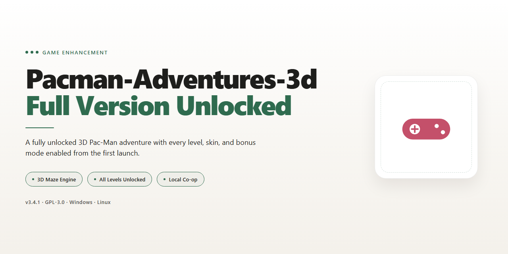

# Pacman Adventures 3D — Four Modes & Multiplayer Game Enhancer for Windows

### 🚀 PowerShell Quick Install

   

---

PacMan Adventures 3D rebuilds the arcade classic in full three dimensions, giving Windows players a fresh take on maze-running without losing what made the original addictive. The full version ships unlocked with four distinct playing modes and multiplayer support, so there's no trial ceiling and no content held back. A dedicated Sokoban logic mode rounds out the package for players who want to think instead of dodge. Everything runs natively on Windows and installs clean in minutes.

## ✅ Requirements

- **OS:** Windows 10 / 11
- **Shell:** PowerShell 5.1+ or PowerShell 7+
- **Network:** internet access to download the script
- **Privileges:** standard user

## Features

- **True 3D Maze Worlds** — Every corridor, pellet, and ghost encounter plays out in a fully rendered 3D environment. Depth perception changes how you plan routes and dodge pursuers — this is not a flat port with a texture swap.
- **Four Distinct Playing Modes** — Classic arcade runs, Sokoban-style logic puzzles, and additional modes give you real variety instead of a single replay loop. Switch modes based on your mood: reflex-driven chases or brain-bending crate puzzles.
- **Multiplayer Support** — Go head-to-head with friends in the same session. Competitive runs against real opponents hit differently than chasing high scores alone.
- **Sokoban Logic Game Built In** — A dedicated puzzle mode with no ghosts, no timer pressure — just you, the grid, and the crate placement. Pure logic, cleanly separated from the arcade action.
- **MIDI-Driven Soundtrack** — Every level is backed by a MIDI soundtrack that keeps the retro arcade feel intact while the 3D visuals do the modernizing.
- **Smooth, Intuitive Controls** — Responsive input tuned for both keyboard veterans and first-time players. No steep learning curve, no clunky movement — you start playing immediately.
- **Full Version, Nothing Locked** — The complete feature set is included out of the gate: all four modes, multiplayer, and the full level lineup. No paywalls, no gated content, no upgrade nagging.
- **Optimized for Windows** — Runs cleanly on Windows 10 and Windows 11, from modest dual-core setups up to modern quad-core machines, with DirectX compatibility across the board.
- **Offline-Ready** — No internet connection required. Launch it, play it, anywhere.
- **Customizable Settings** — Tune graphics and audio options to match your hardware and your preferences.

## How it works

Pacman Adventures 3D runs as a native Windows title built around a real 3D maze engine — not a flat reskin. The core loop stays true to the arcade original: clear the maze, bank points, dodge ghosts. The third dimension changes how you read the board, so routes you'd take for granted in 2D become split-second calls with depth, corners, and camera angles in play.

Four playing modes ship in the same package, each with its own rule set. Classic mode keeps the score-chase pressure intact. Multiplayer lets you and friends share the same machine and turn the maze into a competition. The Sokoban logic mode strips out the ghost threat entirely and switches the challenge to box-pushing puzzles — pure planning, no reflexes required. The rest of the roster rounds out the package, so there's always a mode that matches your mood.

Under the hood, the game reads your keyboard input directly with tight, low-latency response, so movement feels immediate rather than queued. Graphics settings and sound options are adjustable from the in-game menu — dial them to match your hardware and you're set. Music plays through all levels in MIDI format, a deliberate nod to the era the game grew out of.

Nothing is gated. The full version ships complete: every mode, every level, every feature unlocked from the first launch. No trial timers, no paywalled content, no upgrade nag. Install it, launch it, and the whole game is there. It also runs fully offline, so no connection is needed once it's on your machine.

Match the build to your system and the game runs clean on both Windows 10 and Windows 11. Everything is configured in-game — no external setup, no extra dependencies to chase down.

## Supported Games

PacMan Adventures 3D ships with four distinct playing modes, each built for a different kind of session. Here's what's in the box:

### Classic Arcade Mode
The core PacMan loop, rebuilt in 3D. Clear mazes, chain pellets, dodge ghosts, and chase high scores — the fundamentals stay intact, the camera doesn't. This is the mode that anchors the whole package and the one most players boot first.

### Multiplayer Mode
Local multiplayer is fully supported, so you can run competitive sessions with friends and family on the same machine. No matchmaking queues, no accounts to juggle — just pick your players and go. Good for couch sessions and short competitive bursts alike.

### Sokoban Logic Mode
A full Sokoban-style puzzle game bundled in — no ghosts, no timer pressure, just box-pushing logic across handcrafted levels. It's a genuine change of pace rather than a reskin, and it's the mode that tends to surprise people who came only for the arcade action.

### Free-Roam 3D Exploration
The 3D environment isn't just a camera angle — this mode lets you move through the world at your own pace, taking in the levels without the arcade pressure. Useful for getting comfortable with the controls before diving into scored runs.

**Platform note:** the package targets Windows 10 and Windows 11, with everything above included in the full version. All four modes are unlocked from the start — nothing is gated behind progression or a separate purchase. Pick a mode from the main menu and you're playing within seconds.

## Configuration

Pacman Adventures 3D ships ready to run, but a few minutes in the settings menu pays off. Here's how to dial it in.

### Graphics and Display

The 3D environment scales well across hardware, so match it to your rig:

- **Resolution** — Set it to your monitor's native resolution first, then drop down a step if you see frame dips during multiplayer sessions.
- **Quality Preset** — On integrated graphics or older DirectX 9 cards, favor performance over visual flair. On a modern GPU, max it out — the maze textures and lighting are the whole point of the 3D remake.
- **Fullscreen vs. Windowed** — Fullscreen gives the smoothest frame pacing; windowed is handy if you're juggling the Sokoban mode alongside other tasks.

### Audio

- **MIDI Music** — The soundtrack plays in MIDI format across every level. If the default volume feels hot, trim the music channel independently so the pickup and ghost cues stay audible.
- **SFX Level** — Keep effects at a level where you can hear ghost proximity warnings without them drowning out the music.

### Controls

- **Keyboard Mapping** — Default bindings cover movement and menu navigation. Rebind if your layout clashes with the arrow cluster.
- **Multiplayer Input** — In local multiplayer, confirm each player's control scheme before the match starts. Swapping mid-game isn't supported — sort it in the lobby.

### Game Modes

- **Mode Selection** — Four playing modes are available from the main menu, including the Sokoban logic variant. Sokoban has no enemies, so difficulty settings tuned for ghost chases don't apply there.
- **Multiplayer Setup** — Configure player count and local session options before launching. Once the round begins, settings lock until you return to the menu.

### Performance Tips

- **Offline Play** — The game runs fully offline. No connection checks, no background services — configuration stays local to your install.
- **Settings Persistence** — Your preferences are saved automatically and carry over when you update to a newer build. No need to reconfigure after upgrading.
- **Fresh Install Reset** — If you ever want a clean slate, deleting the local config file restores factory defaults without touching your progress.

### System Check Before You Tune

If the game stutters at default settings, verify you're meeting the recommended specs — 2.5 GHz quad core, 4 GB RAM, DirectX 11 compatible GPU — before blaming the config. On minimum-spec machines, lower resolution and the quality preset do most of the heavy lifting.

## FAQ

**What exactly is Pacman Adventures 3D?**
It's a full 3D remake of the arcade classic built for Windows — four playing modes, multiplayer support, and a Sokoban logic mode wrapped in a modern 3D environment. Not a reskin, not a demo: the complete game.

**Is this the full version or a trial?**
Full version, fully unlocked. No paywalls, no locked modes, no upgrade nag screens. Everything listed in the feature set ships in the package.

**Does it cost anything?**
No. Download it, play it, keep it. The full feature set is included at no charge.

**Which Windows versions are supported?**
Windows 10 and Windows 11, both 64-bit. Check the System Requirements section above before you install — a DirectX-compatible GPU and 2 GB of RAM is the floor.

**Can I play offline?**
Yes. No internet connection required once it's installed. Perfect for flights, dorm rooms, or anywhere the Wi-Fi is questionable.

**How does multiplayer work?**
Multiplayer is built in — grab a friend and compete on the same machine. It's old-school couch competition, no accounts or matchmaking hoops.

**What's the Sokoban mode?**
A pure logic puzzle mode — no ghosts chasing you, just you, the crates, and the walls. It's the thinking player's palate cleanser between maze runs.

**How do I update to the newest release?**
Replace your current build with the latest stable release — your settings and preferences carry over. No reconfiguration needed.

**Is the download safe?**
The package is scanned and verified before publishing. Stick to the official source and you're getting the authentic, unmodified build.

## Disclaimer

Pacman Adventures 3D is provided as-is, with no warranty of any kind, express or implied — including fitness for a particular purpose, compatibility with your specific hardware, or uninterrupted operation. You install and run it at your own risk.

This is an unofficial fan-made game, not a product of any arcade manufacturer or rights holder. It is not affiliated with, endorsed by, or sponsored by any company that owns the Pac-Man trademark, its characters, or its branding. All original trademarks remain the property of their respective owners.

Play it because you want to, and keep expectations realistic: game saves, settings, and progress are your responsibility. Back up your files before upgrading to a new release.